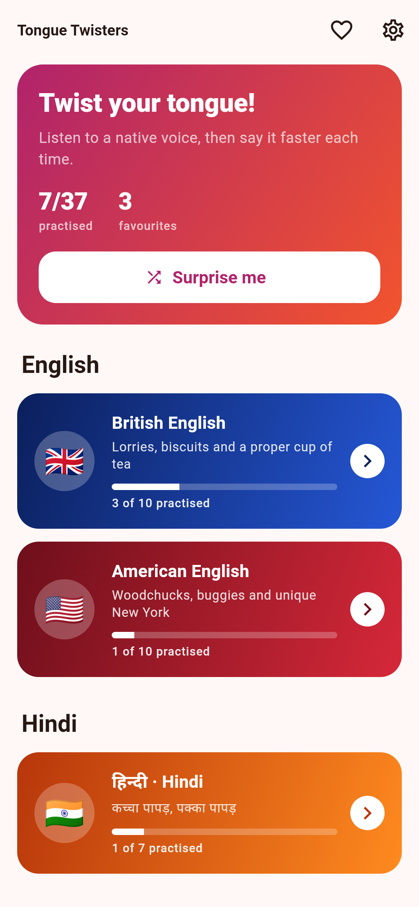
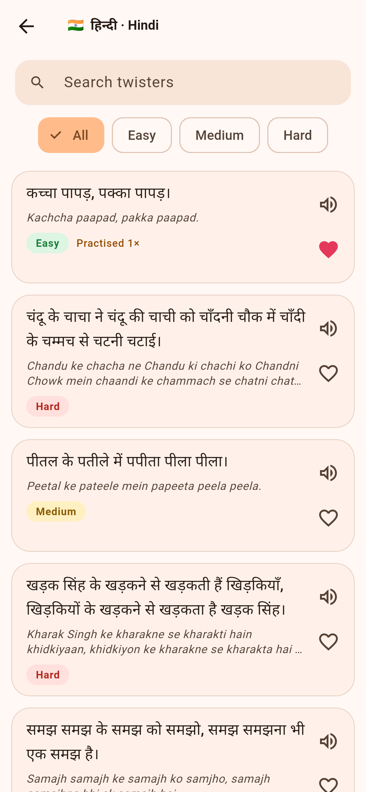
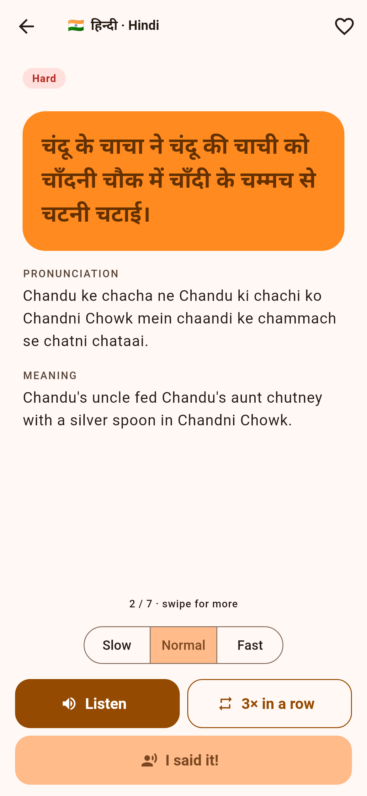
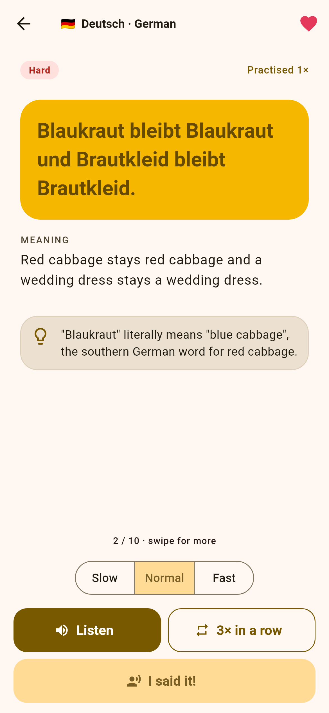
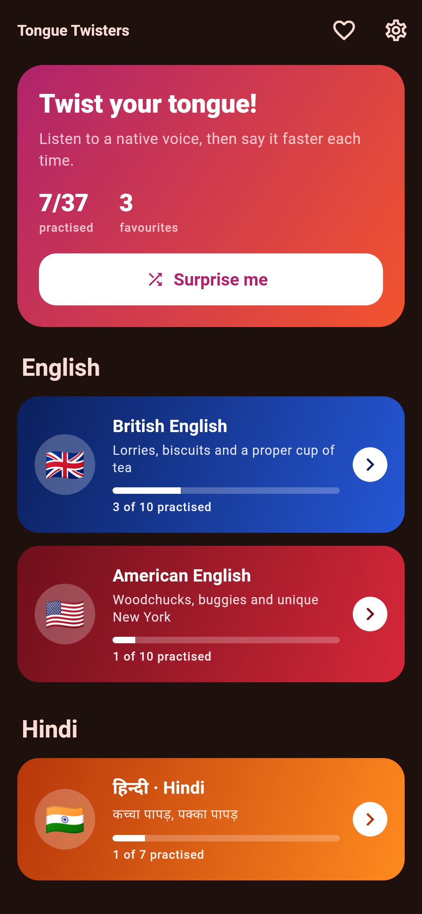
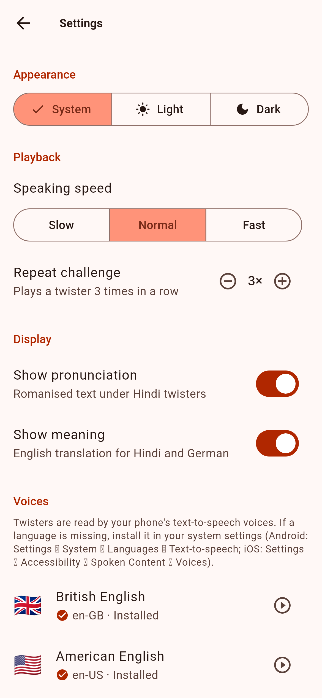

# Tongue Twisters

A Flutter app (iOS and Android) for practising tongue twisters in four sections:

| Section | Voice | Notes |
| --- | --- | --- |
| 🇬🇧 British English | `en-GB` | British vocabulary (lorry, biscuits) and pronunciation tips |
| 🇺🇸 American English | `en-US` | American classics (woodchuck, buggy bumpers, unique New York) |
| 🇮🇳 Hindi | `hi-IN` | Devanagari text, romanised pronunciation and English meaning |
| 🇩🇪 German | `de-DE` | Zungenbrecher with English meaning |

## Features

- **Listen** to each twister in the section's native accent using the device's text-to-speech engine, at slow, normal or fast speed.
- **3× in a row** plays a twister three times back to back, the classic challenge.
- **I said it!** logs a practice attempt. Each section shows how many of its twisters you've practised.
- **Favourites** from any section, saved between launches.
- **Search** and **difficulty filters** (easy, medium, hard) in each section.
- **Surprise me** opens a random twister.
- Swipe left and right on the practice screen to move between twisters.
- **Settings**: light, dark or system theme; default speaking speed; repeat-challenge length (2–5×); show or hide pronunciation and meanings; a voice check that shows which language voices are installed, with a test button for each; reset progress; clear favourites.
- Each language has its own colours: royal blue for British English, crimson for American, saffron for Hindi and gold for German. Difficulty badges use traffic-light colours, and light and dark themes are both supported.
- Custom app icon on iOS and Android, including an Android adaptive icon.

## Download

Every push builds the app in **GitHub Actions** (the *Build* workflow). Download `tongue-twisters-android` or `tongue-twisters-ios` from a run's **Artifacts** section.

Pushing a version tag publishes both files to the repo's **Releases** page:

```sh
git tag v1.0.1 && git push origin v1.0.1
```

| File | How to install |
| --- | --- |
| `tongue-twisters.apk` | Open it on an Android phone and allow "install unknown apps". It is signed with the debug key, which is fine for sideloading. Use your own key before publishing to Google Play. |
| `tongue-twisters-unsigned.ipa` | iOS requires signing. Sign and install it with Sideloadly or AltStore using your Apple ID, or run `flutter run --release` from a Mac with Xcode. App Store or TestFlight distribution needs an Apple Developer account. |

<p>
  
  
  
  
</p>
<p>
  
  
</p>

## Architecture

State management uses [Riverpod 3](https://riverpod.dev) (`flutter_riverpod`), with no code generation.

```
lib/
  main.dart                 loads SharedPreferences, starts ProviderScope
  app.dart                  MaterialApp and theme
  models/                   LanguageSection (sections and TTS locales), Twister, Difficulty
  data/                     bundled twisters, one file per section, plus TwisterRepository
  providers/
    twister_providers.dart  catalogue, per-section lists, lookup by id
    favorites_provider.dart FavoritesNotifier (persisted)
    practice_provider.dart  PracticeNotifier (persisted counts), section progress
    settings_provider.dart  SettingsNotifier: theme, speed, repeats, display (persisted)
    speech_provider.dart    SpeechEngine (flutter_tts wrapper), SpeechController, voice check
  screens/                  home, section list, practice detail, favourites, settings
  widgets/                  twister card, difficulty badge, speak button
  theme/app_theme.dart      brand and per-section colours, buildTheme(), SectionTheme
```

See [AGENTS.md](AGENTS.md) for conventions, content rules and how to add a language. Claude Code users also get [CLAUDE.md](CLAUDE.md) and two project subagents in `.claude/agents/`.

`SpeechEngine` is an interface, so tests replace text-to-speech with a fake (see `test/helpers.dart`).

## Adding twisters

Add a `Twister(...)` entry to the matching file in `lib/data/`. Give it a unique `id`; favourites and practice counts are stored by id. Hindi entries need `transliteration` and `translation`, and German entries need `translation`. `test/data_test.dart` enforces these rules.

To add a new language, add a value to `LanguageSection` with its TTS locale, create a data file, and include it in `TwisterRepository.forSection`.

## Running locally

```sh
flutter pub get
flutter run            # on a connected iOS or Android device or simulator
flutter test
flutter analyze
```

### Text-to-speech voices

Playback uses the voices installed on the device. iOS ships with en-GB, en-US, hi-IN and de-DE voices. On Android, the Google speech engine may need the Hindi or German voice data downloaded (Settings → System → Languages → Text-to-speech). If a voice is missing, the app says so instead of failing silently.

The Settings screen shows which voices are installed and lets you test each one.

The Android manifest declares the `TTS_SERVICE` query required on Android 11 and later.

## App icon

The source images are in `assets/icon/`. After changing them, regenerate the platform icons with `dart run flutter_launcher_icons`. If that tool changes `ios/Runner.xcodeproj/project.pbxproj`, revert that file; it's a known bug in the tool.
