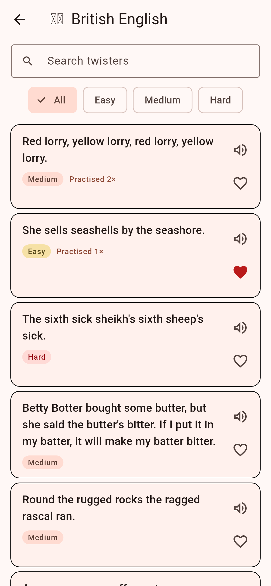
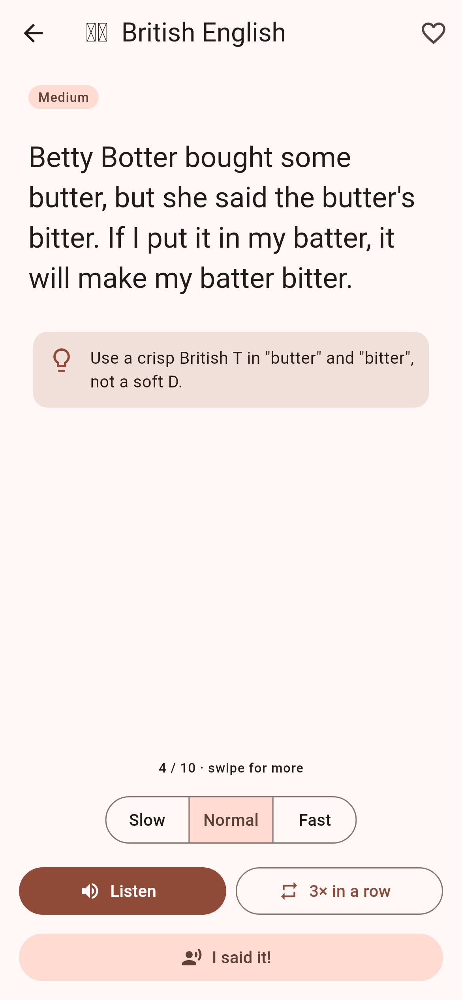

# Tongue Twisters

A Flutter app (iOS and Android) for practising tongue twisters in four sections:

| Section | Voice | Notes |
| --- | --- | --- |
| 🇬🇧 British English | `en-GB` | British vocabulary (lorry, biscuits) and pronunciation tips |
| 🇺🇸 American English | `en-US` | American classics (woodchuck, buggy bumpers, unique New York) |
| 🇮🇳 Hindi | `hi-IN` | Devanagari text, romanised pronunciation and English meaning |
| 🇩🇪 German | `de-DE` | Zungenbrecher with English meaning |

## Features

- **Listen** to each twister in the section's native accent using the device's text-to-speech engine, at slow, normal or fast speed.
- **3× in a row** plays a twister three times back to back, the classic challenge.
- **I said it!** logs a practice attempt. Each section shows how many of its twisters you've practised.
- **Favourites** from any section, saved between launches.
- **Search** and **difficulty filters** (easy, medium, hard) in each section.
- **Surprise me** opens a random twister.
- Swipe left and right on the practice screen to move between twisters.
- Light and dark themes.

<p>
  
  
</p>

## Architecture

State management uses [Riverpod 3](https://riverpod.dev) (`flutter_riverpod`), with no code generation.

```
lib/
  main.dart                 loads SharedPreferences, starts ProviderScope
  app.dart                  MaterialApp and theme
  models/                   LanguageSection (sections and TTS locales), Twister, Difficulty
  data/                     bundled twisters, one file per section, plus TwisterRepository
  providers/
    twister_providers.dart  catalogue, per-section lists, lookup by id
    favorites_provider.dart FavoritesNotifier (persisted)
    practice_provider.dart  PracticeNotifier (persisted counts), section progress
    speech_provider.dart    SpeechEngine (flutter_tts wrapper) and SpeechController
  screens/                  home, section list, practice detail, favourites
  widgets/                  twister card, difficulty badge, speak button
```

`SpeechEngine` is an interface, so tests replace text-to-speech with a fake (see `test/helpers.dart`).

## Adding twisters

Add a `Twister(...)` entry to the matching file in `lib/data/`. Give it a unique `id`; favourites and practice counts are stored by id. Hindi entries need `transliteration` and `translation`, and German entries need `translation`. `test/data_test.dart` enforces these rules.

To add a new language, add a value to `LanguageSection` with its TTS locale, create a data file, and include it in `TwisterRepository.forSection`.

## Running

```sh
flutter pub get
flutter run            # on a connected iOS or Android device or simulator
flutter test
flutter analyze
```

### Text-to-speech voices

Playback uses the voices installed on the device. iOS ships with en-GB, en-US, hi-IN and de-DE voices. On Android, the Google speech engine may need the Hindi or German voice data downloaded (Settings → System → Languages → Text-to-speech). If a voice is missing, the app says so instead of failing silently.

The Android manifest declares the `TTS_SERVICE` query required on Android 11 and later.
